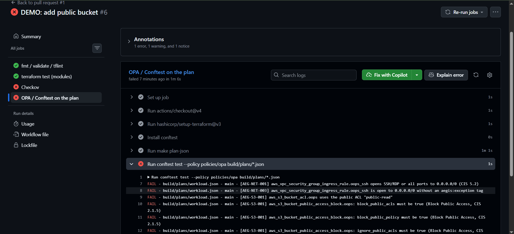
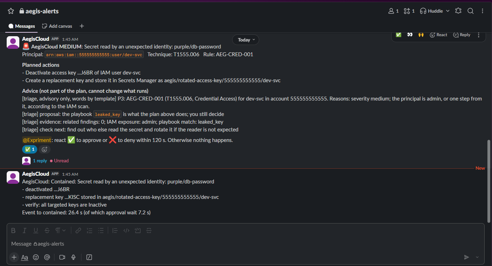
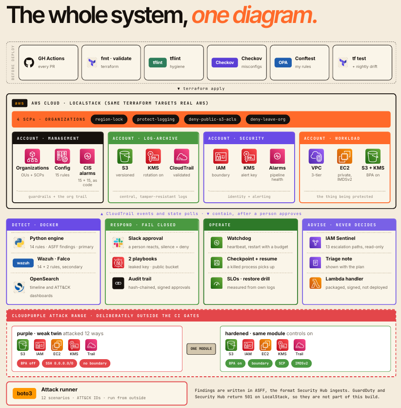
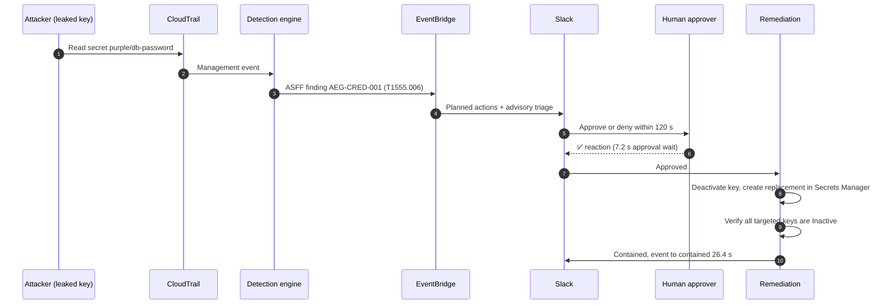

<div align="center">

# 🛡️ AegisCloud

**A Terraform-built, CIS-mapped AWS landing zone that gets attacked on purpose, detects the attack, and fixes itself, with a human in the loop.**

[](https://github.com/LAKHAL-Farah/aegis-cloud/actions/workflows/terraform-ci.yml)


*Build → Attack → Detect → Respond → Prove*

</div>

---

## What is this?

AegisCloud is a **Detection-as-Code and auto-remediation platform for AWS**. It runs entirely on your laptop using [LocalStack for AWS](https://www.localstack.cloud/), so it costs nothing to run, and the same Terraform can target real AWS by swapping the provider endpoints.

Most cloud-security portfolios stop at "I deployed a VPC." AegisCloud closes the whole loop and **measures every step**:

| Step | What happens | What it produces |
| --- | --- | --- |
| **Build** | A multi-account landing zone, defined in Terraform, gated by policy-as-code in CI | A compliance score ("N of M CIS controls") |
| **Attack** | A deliberately vulnerable twin is attacked with ATT&CK-mapped scenarios | A scorecard, with a "0 detected" baseline recorded *before* any detection existed |
| **Detect** | Our own detection engine reads CloudTrail and emits ASFF findings | ATT&CK coverage matrix and time-to-detect |
| **Respond** | Findings go to Slack with approve/deny buttons; approved actions run via Lambda | Time-to-respond, audit trail |
| **Prove** | Every attack is re-run as a regression test against every remediation | Numbers, not claims |

---

## See it work

### 1. An insecure Terraform PR gets blocked

A pull request that adds a public bucket and an SSH rule open to `0.0.0.0/0` fails CI. The OPA/Conftest gate reports exactly which rule was violated and which CIS control it maps to. Checkov fails the same PR independently.



*PR #6 "DEMO: add public bucket." `fmt / validate / tflint` and `terraform test` pass; `Checkov` and `OPA / Conftest on the plan` fail with `AEG-NET-001`, `AEG-NET-003` and `AEG-S3-001` (CIS 2.1.5, 5.2).*

### 2. A leaked key is detected, triaged, approved and contained in 26 seconds

A leaked credential reads a secret it should never touch. AegisCloud detects it, maps it to ATT&CK, posts the plan to Slack, waits for a human to react ✅, then deactivates the key, issues a replacement into Secrets Manager and **verifies** the result.



*Rule `AEG-CRED-001` / ATT&CK `T1555.006`. Event to contained: **26.4 s**, of which **7.2 s** was the human approval wait.*

---

## The cool parts

- **Attacked on purpose.** The project ships its own attack range (`purple/` resources) and runs ATT&CK-mapped scenarios against it. You see the "before" (blind) and the "after" (detected), not just the after.
- **Honest baseline first.** The scorecard was recorded at "0 of N detected" *before* any detection rule existed, so every improvement is measurable.
- **Prevent / Detect / Neither.** Each attack is scored on whether an SCP or permissions boundary *blocked* it, whether we *caught* it, or whether *neither* happened. That last column is where the honest learning is.
- **Detection-as-Code with ASFF output.** Detections emit findings in AWS Security Finding Format, so on real AWS the same findings could feed Security Hub unchanged.
- **Human-in-the-loop by design.** Risky actions need an explicit approval. No reaction within the window (120 s) means **nothing happens**.
- **A triage advisor that cannot change the plan.** The advice block (severity, IAM exposure, related findings, suggested next check) is clearly labelled *advisory only*. It cannot alter what the remediation executes. Slack shows the planned actions and the advice as separate sections.
- **Verify, don't assume.** Containment ends with a check ("all targeted keys are Inactive") before the message says *Contained*.
- **Policy-as-code at three layers.** Checkov, OPA/Conftest on the Terraform plan JSON, and `terraform test` per module, all required before merge.
- **Our own compliance score.** LocalStack doesn't implement Config evaluation, so the score is computed from the plan (preventive), live boto3 checks (actual state) and Config rule definitions (portability only). See [ADR-0003](docs/adr/).
- **Same Terraform on real AWS.** Managed services (GuardDuty, Security Hub) sit behind `enable_managed_security`: `false` on LocalStack, `true` on real AWS.
- **Gaps are documented, not hidden.** `docs/localstack-limitations.md` lists what the emulator can't do and how the project works around it.

---

## Architecture

### Layered view

AegisCloud is built as seven layers on top of a platform layer. Each layer only depends on the ones below it, so you can ship and demo them stage by stage.




| Layer | Responsibility | Key pieces |
| --- | --- | --- |
| **L7 Human interface** | Where people see and decide | Slack approve/deny, Kibana dashboards, GitHub PR checks |
| **L6 Intelligence** *(optional)* | Make it smart, never in charge | Advisory triage, IAM Sentinel graph, LangGraph agent |
| **L5 Response** | Give it reflexes | EventBridge routing, approval gate, Lambda/SSM remediation, verify + audit |
| **L4 Detection** | Give it eyes | `AEG-*` detection rules, ASFF findings, Wazuh, Falco, ELK/OpenSearch |
| **L3 Attack simulation** | Prove the defences | ATT&CK-mapped scenarios, prevent/detect/neither scorecard |
| **L2 Preventive gates** | Stop bad infra before it exists | tflint, Checkov, OPA/Conftest, `terraform test`, Infracost, drift |
| **L1 Landing zone** | A secure-by-default foundation | 4 accounts, SCPs, 3-tier VPC, KMS-encrypted S3, roles + boundaries, org trail |
| **L0 Platform** | Where it all runs | LocalStack for AWS locally; the same Terraform targets real AWS |

### Runtime flow

What happens while the system is running, from attack to verified fix:


### Leaked-key playbook, step by step

This is the exact sequence from the Slack screenshot above.



---

## Tech stack

<div align="center">

### Infrastructure and platform


### Policy as code and CI/CD


### Detection and observability


### Response and automation


### Languages and tooling


### Frameworks and standards


</div>

### Stack at a glance

| Area | Tools | Used for |
| --- | --- | --- |
| **IaC** | Terraform ≥ 1.6, `.tftest.hcl` | Landing zone, remote state in S3 on LocalStack, module tests |
| **Cloud (emulated)** | LocalStack: Organizations, SCPs, IAM, STS, S3, KMS, CloudTrail, EventBridge, SQS, Lambda, Secrets Manager, SSM | Everything runs locally for free |
| **Policy as code** | OPA/Conftest (Rego), Checkov, tflint | Blocking insecure PRs |
| **Detection** | Python engine (ASFF), Wazuh, Falco, ELK/OpenSearch | Turning CloudTrail into ATT&CK-mapped findings |
| **Response** | EventBridge, Lambda, SSM Automation, Slack, n8n | Approved, verified, audited remediation |
| **CI/CD** | GitHub Actions | Terraform CI, nightly drift, Infracost comments |
| **Standards** | MITRE ATT&CK, CIS AWS Foundations, ASFF | Every rule and control is mapped |

---

## CI gates

Every pull request has to pass all of these before it can merge.

| Gate | Job | What it catches |
| --- | --- | --- |
| Format / validate / lint | `fmt / validate / tflint` | Style, syntax, provider-specific mistakes |
| Module tests | `terraform test (modules)` | Behavioural assertions (for example SCP content) |
| Checkov | `Checkov` | Encryption, versioning, Block Public Access and similar misconfigurations |
| OPA / Conftest | `OPA / Conftest on the plan` | Custom rules on the Terraform **plan JSON** |
| Cost | Infracost | Cost impact comment on the PR |
| Drift | Nightly `terraform plan -detailed-exitcode` | Opens an issue when reality diverges from code |

### Custom OPA rules (examples)

| Rule | Meaning | CIS |
| --- | --- | --- |
| `AEG-S3-001` | Buckets must have all four Block Public Access flags on and no public ACL | 2.1.5 |
| `AEG-NET-001` | No ingress opens SSH/RDP or all ports to `0.0.0.0/0` | 5.2 |
| `AEG-NET-003` | Any `0.0.0.0/0` exception must carry an `aegis:exception` tag | n/a |

---

## Detection and response

### Detections

Each detection carries a rule ID, an ATT&CK technique and an expected severity, and emits a finding in ASFF. Example from the demo above:

| Rule | Technique | Description |
| --- | --- | --- |
| `AEG-CRED-001` | T1555.006 (Cloud Secrets Management Stores) | Secret read by an unexpected identity |

The attack range is built around scenarios like these:

| Scenario | ATT&CK |
| --- | --- |
| Read a secret with a leaked access key | T1555.006 |
| Exfiltrate data from S3 | T1530 |
| Create a backdoor IAM user | T1136.003 |
| Disable CloudTrail | T1562.008 |
| Open a security group to `0.0.0.0/0` | T1562.007 |

### Playbooks

| Playbook | Actions |
| --- | --- |
| `leaked_key` ⭐ | Deactivate the access key, create a replacement stored in Secrets Manager, verify all targeted keys are inactive |
| `public_bucket` | Re-apply Block Public Access, return bucket to private |
| `quarantine_instance` | Swap the instance's security group for an isolation group |
| `forensic_snapshot` | Snapshot the disk before any destructive action |

### How a remediation is kept safe

1. **Plan first.** The Slack message lists the exact actions that will run.
2. **Advice is separate.** The triage block is advisory and cannot change the plan.
3. **Explicit approval.** A ✅ reaction from the named approver starts it; ❌ or silence for 120 s does nothing.
4. **Verify.** The result is checked against the real state before it is reported as contained.
5. **Measure.** Event-to-contained time and approval wait time are reported on every run.

---

## The scorecard

Every scenario is scored on **Prevent / Detect / Neither**, with time-to-detect and time-to-respond.

| Metric | Value |
| --- | --- |
| Attack scenarios | _N_ |
| ATT&CK techniques covered | _N_ |
| Baseline (before detections) | **0 of _N_ detected** |
| Current coverage | _X_ % |
| MTTD | _Y_ s |
| Leaked-key playbook, event to contained | **26.4 s** (7.2 s was human approval) |
| CIS controls enforced as code | _N of M_ |

> Numbers marked with italics are filled in from the latest scorecard run. Misses are listed honestly in the coverage matrix, with notes on why.

---

## Compliance and CIS mapping

`docs/cis-mapping.md` maps each control to its Terraform resource, its **preventive** check and its **detective** check.

| CIS control | Requirement | Preventive | Detective |
| --- | --- | --- | --- |
| 2.1 | CloudTrail enabled in all regions | Checkov | Live check |
| 2.1.5 | S3 Block Public Access | Checkov + OPA `AEG-S3-001` | Live check |
| 2.6 | S3 access logging on the trail bucket | Checkov | Live check |
| 4.1 / 5.2 | No security group open to `0.0.0.0/0` on admin ports | OPA `AEG-NET-001` | Live check |
| 5.x | Default VPC security group restricts all traffic | Checkov | Live check |

`scripts/compliance_score.py` merges plan checks, live boto3 checks and rule definitions, and prints **"N of M controls passing"** as JSON and Markdown.

> Check IDs are verified against the CIS benchmark version and Checkov release in use.

---

## Repository layout

```
aegis-cloud/
├── README.md
├── Makefile                       up / down / spike / fmt / plan / test
├── docker-compose.yml             LocalStack for AWS
├── spike/                         feasibility spike (what LocalStack supports)
├── terraform/
│   ├── modules/
│   │   ├── organization/          org, OUs, SCPs, member accounts
│   │   ├── network/               3-tier VPC, NACLs, SGs, endpoints, flow logs
│   │   ├── iam-baseline/          password policy, permission boundaries, roles
│   │   ├── logging/               org trail, log-archive bucket, KMS, access logs
│   │   ├── config-rules/          Config recorder + CIS-style rules
│   │   ├── data/                  KMS-encrypted S3, BPA, versioning, lifecycle
│   │   └── compute/               private instances, SSM role, no public IPs
│   ├── live/
│   │   ├── management/            org, SCPs, org trail
│   │   ├── log-archive/           central log bucket
│   │   ├── security/              detection stack
│   │   └── workload/              network, data, compute
│   └── tests/                     terraform test (.tftest.hcl) per module
├── policies/
│   ├── opa/                       Conftest rules on plan JSON
│   ├── scp/                       SCP JSON kept out of HCL
│   └── checkov/                   custom checks + skip justifications
├── scripts/
│   ├── compliance_score.py        plan + live checks → score
│   └── drift_check.sh             scheduled plan -detailed-exitcode
├── docs/
│   ├── cis-mapping.md
│   ├── localstack-limitations.md
│   ├── threat-model.md
│   ├── img/                       screenshots used in this README
│   └── adr/                       architecture decision records
└── .github/workflows/
    ├── terraform-ci.yml           fmt, validate, tflint, checkov, conftest, test
    ├── drift.yml                  nightly plan, opens an issue on drift
    └── infracost.yml              cost comment on PRs
```

---

## Multi-account on LocalStack

LocalStack derives the account ID from a 12-digit access key, so one provider alias per account is all it takes to simulate a multi-account organization:

```hcl
provider "aws" {
  alias      = "log_archive"
  access_key = "222222222222"   # 12-digit key becomes the account ID
  secret_key = "test"
  # same endpoints block as spike/providers.tf
}
```

| Account | Purpose |
| --- | --- |
| management | Organization, OUs, SCPs, org trail |
| log-archive | Central, immutable-style log bucket |
| security | Detection and response stack |
| workload | The thing being protected (and attacked) |

---

## Quick start

**Requirements:** Docker, Terraform ≥ 1.6, AWS CLI v2, curl, Python 3, and a LocalStack student/hobby auth token.

```bash
# 1. Start LocalStack
export LOCALSTACK_AUTH_TOKEN=<your token>
make up

# 2. Run the feasibility spike (applies probes and runs behaviour checks)
make spike
cat spike/spike-report.md

# 3. Format, plan and test
make fmt
make plan
make test

# 4. Manual CLI calls against LocalStack
export AWS_ACCESS_KEY_ID=test AWS_SECRET_ACCESS_KEY=test AWS_DEFAULT_REGION=us-east-1
aws --endpoint-url http://localhost:4566 sts get-caller-identity
```

> 💡 On Windows, keep the repo in the WSL Linux filesystem (`~/aegis-cloud`), not under `/mnt/c`. It's dramatically faster.

---

## What LocalStack can and can't do

A feasibility spike tested the student/hobby tier before any design decision was made.

| Capability | Result | Notes |
| --- | --- | --- |
| Organizations + SCPs | ✅ Works | Apply and API calls pass |
| Multi-account via 12-digit keys | ✅ Works | `sts get-caller-identity` returns the chosen account |
| CloudTrail | ✅ Works | Status, `lookup-events` and S3 delivery pass |
| EventBridge → SQS | ✅ Works | Round trip passes |
| Config recorder and rules | ⚠️ Stored only | Evaluation APIs are not implemented |
| GuardDuty | ❌ Not supported | API returns 501 |
| Security Hub | ❌ Not supported | API returns 501 |

These gaps shaped the design: a custom detection engine, ASFF output, and a compliance score that doesn't depend on Config evaluation. Full details, including the exact LocalStack version and date, are in [`docs/localstack-limitations.md`](docs/localstack-limitations.md).

---

## Architecture decisions

This project records decisions 0001 to 0023:

| ADR | Decision |
| --- | --- |
| 0001 | Multi-account via 12-digit access keys, one provider alias per account |
| 0002 | Own detection engine with ASFF output (Wazuh rules + Python detections) |
| 0003 | Compliance score computed by us (plan + live checks + rule definitions), not by Config |
| 0004 | Managed-services toggle: `enable_managed_security` is `false` on LocalStack, `true` on real AWS |
| 0005 | No Config auto-remediation; remediation triggers come from our own detections via EventBridge |
| [ADR-0019](docs/adr/0019-iam-sentinel-in-memory-graph-read-only.md) | IAM Sentinel uses a read-only in-memory graph |
| [ADR-0020](docs/adr/0020-triage-code-decides-model-explains.md) | Triage code decides; the model explains |
| [ADR-0021](docs/adr/0021-signed-reproducible-releases.md) | Releases are signed and reproducible |
| [ADR-0022](docs/adr/0022-claims-are-generated-from-evidence.md) | Claims are generated from evidence |
| [ADR-0023](docs/adr/0023-one-executing-responder-per-state-directory.md) | One executing responder per state directory |

## Status

| 1. SecureLanding | Build it right | Modules, CI gates, CIS mapping, compliance score, drift detection |
| 2. CloudPurple | Attack it, prove you're blind | Vulnerable twin, attack scenarios, "0 detected" baseline |
| 3. Detection | Give it eyes | Detection engine, ATT&CK coverage matrix, MTTD |
| 4. Response | Give it reflexes | Playbooks, approval flow, MTTR |
| 5. Operate and survive | Prove it's resilient | Alarms, patching, backup restore tests, chaos experiment, SLOs |
| 6. Intelligence | Make it smart | IAM Sentinel, LangGraph triage agent |
| 7. Polish | Ship it | Diagrams, threat model, signed artifacts, demo video |

---

## Roadmap

| Stage | Theme | Outcome |
| --- | --- | --- |
| **1. SecureLanding** | Build it right | Modules, CI gates, CIS mapping, compliance score, drift detection |
| **2. CloudPurple** | Attack it, prove you're blind | Vulnerable twin, attack scenarios, "0 detected" baseline |
| **3. Detection** | Give it eyes | Detection engine, ATT&CK coverage matrix, MTTD |
| **4. Response** | Give it reflexes | Playbooks, approval flow, MTTR |
| **5. Operate and survive** | Prove it's resilient | Alarms, patching, backup restore tests, chaos experiment, SLOs |
| **6. Intelligence** *(optional)* | Make it smart | IAM Sentinel, LangGraph triage agent |
| **7. Polish** | Ship it | Diagrams, threat model, signed artifacts, demo video |

---

## Honest limitations

- **It's an emulator.** LocalStack doesn't behave identically to AWS. Anything simulated is labelled as simulated.
- **No managed threat detection locally.** GuardDuty and Security Hub are not available, so detection is our own engine. On real AWS they could be switched on with one variable.
- **SCP enforcement** for the management account is exempt in real AWS; enforcement is tested with member accounts.
- **Coverage is not 100%.** The scorecard lists what is missed, and why.
- **Non-commercial.** The LocalStack student/hobby license is non-commercial, so this is a learning and portfolio project, not a product.

## What this does not show

- **It does not show production security on real AWS.** The demos and scorecards are simulated on LocalStack.
- **It does not show complete ATT&CK coverage.** For example, S08 is documented as a limitation rather than presented as detected.
- **It does not show a guarantee that every attack is prevented.** The scorecard records prevent, detect, and neither outcomes.

---

## Related projects

Part of a wider cloud, GitOps and AIOps portfolio: **Cortex** (agentic AIOps for OpenStack), **Cortex GitOps** (Azure/OpenStack hybrid), **OpenStack IaaS**, **Server Lab**.

## Author

**LAKHAL Farah**: Cloud, DevOps and DevSecOps. Built with Terraform, a lot of Rego, and a deliberately vulnerable S3 bucket.

> ⚠️ The attack range contains deliberately insecure resources. Run it only against LocalStack, never against a real AWS account.