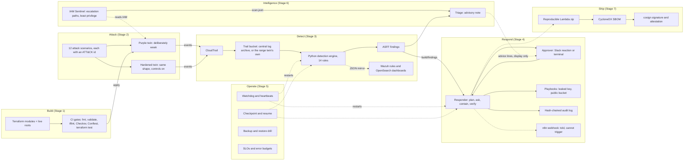
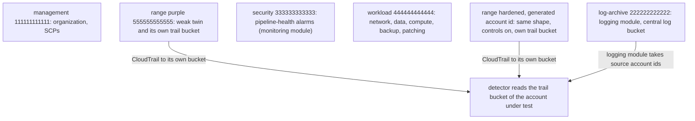
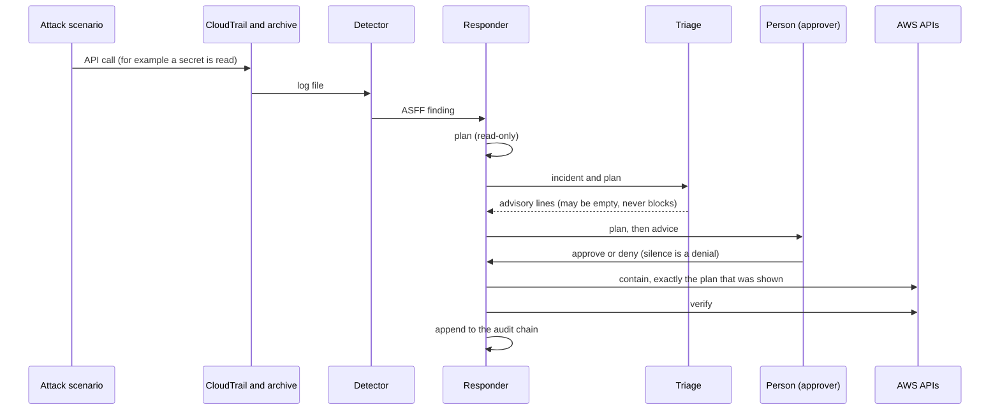

# Architecture

AegisCloud is a loop: **build, attack, detect, respond, operate, prove**. This page shows the parts and how data moves between
them. Everything drawn exists in the repo; the table at the end gives the path of each box (a test checks they exist). What is
*not* connected is marked in the last section: the diagram would otherwise look more finished than the system is.

The diagrams are Mermaid and render on GitHub. They were written without a renderer available, so if one does not draw, the
text under it is the source of truth.

## 1. The whole system

Solid arrows carry data a component needs. Dashed arrows are optional or advisory: nothing downstream of a dashed arrow
waits for it.

## 2. Accounts (all simulated on LocalStack by 12-digit access keys, ADR-0001)

The `terraform/live/` roots are management, log-archive, security and workload. The two range twins are a separate Terraform
tree (`cloudpurple/terraform/`) so a deliberately weak account can never share state with the landing zone.

## 3. One incident, end to end

The triage step cannot change the plan, the decision or what runs (ADR-0020). Its lines are appended after the plan.

## 4. Components and where they live

| Box | Path |
| --- | --- |
| Terraform modules | `terraform/modules/` |
| Live roots (accounts) | `terraform/live/` |
| CI gates | `.github/workflows/terraform-ci.yml`, `policies/` |
| Attack scenarios, twins | `cloudpurple/attacks/`, `cloudpurple/terraform/` |
| Detection engine | `detections/aegis_detect/` |
| Wazuh rules, OpenSearch, Falco rules | `siem/` |
| Responder, playbooks, approvers, audit | `response/aegis_respond/` |
| Watchdog, SLOs, drill, chaos | `ops/aegis_ops/` |
| IAM Sentinel | `sentinel/aegis_sentinel/` |
| Triage | `triage/aegis_triage/` |
| SBOM, signing, headline numbers | `release/` |

## 5. What is not connected

* **No live path from the detector to the Lambda.** The Lambda handler and its package exist and are tested with moto, but
  whether EventBridge on LocalStack delivers to it has not been tested (`docs/response-playbooks.md`).
* **Falco has rules and a bridge, not a scenario.** None of the 12 attacks exercises a container, so there is no measured
  Falco detection (ADR-0011).
* **n8n is told, it does not decide.** It receives incidents through a webhook; it cannot approve or trigger containment (ADR-0015).
* **Sentinel and triage are advisory.** Sentinel's findings go to `build/sentinel/findings/`, not `build/findings/`, so the responder never
  mistakes a standing weakness for an incident.
* **The measured approval was simulated.** The headline response run used an automatic approver; see `docs/lessons-learned.md`.
